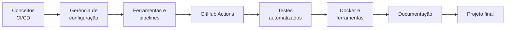

<div align="center">

# DevOps — Fatec

**Resumos, atividades e materiais da disciplina de DevOps.**


[Aulas](#-aulas) · [Projeto final](#-projeto-final--ratemedia) · [Estrutura](#-estrutura) · [Documentos](documentos/README.md) · [Referências](referencias/README.md)

</div>

---

## 📌 Sobre

Este repositório reúne o que foi estudado na disciplina de **DevOps** da Fatec,
ministrada pelo Prof. Me. Deivison S. Takatu: um resumo por aula, as atividades
práticas (cada uma em seu próprio repositório), os slides e os materiais de
apoio.

O semestre seguiu o caminho de uma entrega de software: dos conceitos de
integração e entrega contínua até pipelines no GitHub Actions, testes
automatizados, contêineres, documentação e, por fim, um projeto final que junta
tudo.

## 📚 Aulas

| Aula | Tema | Atividade prática | Slides |
| --- | --- | --- | --- |
| 01 | [Apresentação da disciplina e plano de curso](Aulas/Aula1/Aula1.md) | — | [PDF](documentos/Aula%2001%20-%20Apresenta%C3%A7%C3%A3o%20da%20Disciplina%20e%20Introdu%C3%A7%C3%A3o%20ao%20DevOps.pdf) |
| 02 | [Conceitos de CI/CD e hospedagem na Vercel](Aulas/Aula2/Aula2.md) | — | [PDF](documentos/Aula%2002%20-%20Conceitos%20de%20Integra%C3%A7%C3%A3o%20e%20Entrega%20Cont%C3%ADnua%20de%20Software.pdf) |
| 03 | [Gerência de configuração, dependências e CI/CD](Aulas/Aula3/Docs.md) | [Devops_Aula3](https://github.com/Dracon-46/Devops_Aula3) | [PDF](documentos/Aula%2003%20-%20Ger%C3%AAncia%20de%20Configura%C3%A7%C3%A3o.pdf) |
| 04 | [Ferramentas de CI/CD e pipelines](Aulas/Aula4/Aula4.md) · [pesquisa Azure DevOps × GitHub](Aulas/Aula4/pesquisa.md) | — | [PDF](documentos/Aula%2004%20-%20Ferramentas%20de%20Integra%C3%A7%C3%A3o%20e%20Entrega%20Cont%C3%ADnua.pdf) |
| 05 | [Pipeline de integração contínua com Actions do Marketplace](Aulas/Aula5/Aula5.md) | [Devops_Aula5](https://github.com/Dracon-46/Devops_Aula5) | [PDF](documentos/Aula%2005%20-%20Pipeline%20de%20Integra%C3%A7%C3%A3o%20Cont%C3%ADnua.pdf) |
| 06 | [Pipeline no push da `main` e análise de pipelines reais](Aulas/Aula6/Aula6.md) | [Devops_Aula6](https://github.com/Dracon-46/Devops_Aula6) | [PDF](documentos/Aula%2006%20-%20Revis%C3%A3o%20Ferramentas%20e%20Pipelines.pdf) |
| 07 | [Testes automatizados: unitário, integração e performance](Aulas/Aula7/Aula7.md) | [Devops_Aula7](https://github.com/Dracon-46/Devops_Aula7) | [PDF](documentos/Aula%2007%20-%20Testes%20Automatizados.pdf) |
| 08 | [Apresentação de ferramentas DevOps (grupo: Docker)](Aulas/Aula8/Aula8.md) | — | [PDF](documentos/Aula%2008%20-%20Apresenta%C3%A7%C3%A3o%20Ferramentas%20DevOps.pdf) |
| 09 | [Documentação de software e README](Aulas/Aula9/Aula9.md) | [RateMedia — /docs](https://ratemedia.vercel.app/docs) | [PDF](documentos/Aula%2009%20-%20Documenta%C3%A7%C3%A3o%20de%20Software.pdf) |
| 10 | [Projeto final DevOps](Aulas/Aula10/Aula10.md) | [RateMedia](https://github.com/LuisGlauser/RateMedia) | [PDF](documentos/Aula%2010%20-%20Projeto%20DevOps.pdf) |

## 🚀 Projeto final — RateMedia

O projeto final é o **[RateMedia](https://github.com/LuisGlauser/RateMedia)**,
desenvolvido em grupo: uma plataforma para acompanhar, avaliar e resenhar
animes, mangás, séries e filmes, com campanhas de RPG da comunidade.

| | |
| --- | --- |
| 🌐 Aplicação | <https://ratemedia.vercel.app> |
| 📖 Documentação | [/docs](https://ratemedia.vercel.app/docs) · [Wiki](https://github.com/LuisGlauser/RateMedia/wiki) |
| ✅ Pipeline | Lint, tipos, testes unitários, de integração, E2E e de performance no GitHub Actions |
| 🐳 Contêiner | Dockerfile *multi-stage* e Docker Compose com *healthcheck* |

O mapeamento de cada requisito do projeto para o que foi entregue está na
[Aula 10](Aulas/Aula10/Aula10.md).

## 🗂️ Estrutura

```
Aulas/          um resumo por aula (Aula1 … Aula10)
documentos/     slides das aulas em PDF
referencias/    artigos e materiais de apoio
```

## 🧭 Trilha da disciplina



## 📖 Bibliografia principal

- HUMBLE, J.; PRIKLANDNICKI, R. **Entrega Contínua: como entregar software de forma rápida e confiável**. Bookman, 2013.
- KIM, G.; HUMBLE, J.; DEBOIS, P.; WILLIS, J. **Manual de DevOps**. Starlin Alta Editora, 2018.
- SATO, D. **DevOps na prática: entrega de software confiável e automatizada**. Casa do Código, 2014.
- MUNIZ, A. et al. **Jornada DevOps**. Brasport, 2019.
- VITALINO, J. F. N.; CASTRO, M. A. N. **Descomplicando o Docker**. 2. ed. Brasport, 2018.

---

<div align="center">
<sub>Arthur Gaspare Camzano · <a href="https://github.com/Dracon-46">@Dracon-46</a></sub>
</div>
